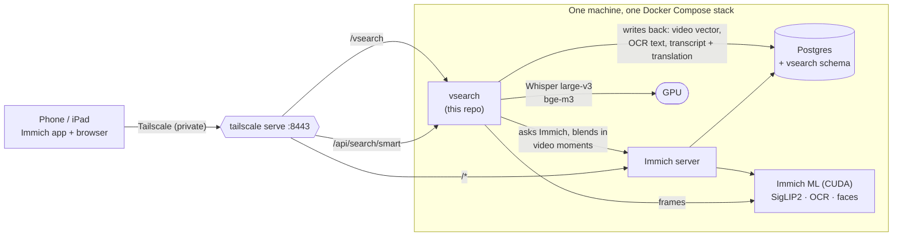

# Immich Video Search

**Find the moment, not just the video.** Search inside your [Immich](https://immich.app) videos by
what's **on screen**, what's **said** (Hindi, Marathi, English and ~95 other languages), and
what's **written**. It works **right in Immich's own search bar**, in the phone apps and on the web.
A companion page jumps to the exact second, and also lets someone with **only a phone**
upload whole pendrives, each tracked and in its own album.

<p align="center">
  
</p>

> Searching "dog" found a clip where someone says *"चलो आज शाम को कुत्ते के साथ पार्क में घूमने
> चलते हैं"* in Hindi. The translation pass turned that into *"Let's go to the park with the dog
> this evening"*, and the player opened at 0:01.

It runs entirely on your own machine and GPU, with no cloud services. It installs as one extra
container next to Immich and needs no new app on anyone's phone.

---

## The problem

It started with **4–5 pendrives full of unsorted photos, videos and clips**, a phone and an iPad that
were both nearly full, and the person they belong to living in another city, 700 km from the
only computer that could organize them.

[Immich](https://immich.app) solves most of that. It's a self-hosted Google Photos, with apps
for phones, automatic backup, a timeline, duplicate detection, faces, and AI search ("beach at
sunset"). But for **videos**, Immich's search has two big blind spots:

1. **It only looks at one frame.** Immich embeds the video's thumbnail and nothing else.
   A 30-second clip where the cat walks in at 0:20 does not exist for the search "cat".
2. **It ignores the audio completely.** You can't find "the clip where everyone sings happy
   birthday", let alone a clip where the talking is in Hindi or Marathi.

Family videos in India are full of both: things happen mid-clip, and people talk in two or three
languages at once while you search in English.

There were constraints too. It had to run on one laptop (an RTX 2000 Ada, 8 GB VRAM) with no
cloud and no new app for the person using it. Access over the internet had to stay private.

## The solution



`vsearch` is a small Python service that lives in the Immich Docker stack:

1. **It finds new videos** in Immich's database and waits until Immich has finished its own processing.
2. **It samples frames.** One frame per scene change, at least every 3 s, capped at 300 per video.
3. **It reads every frame with Immich's own ML container,** using the same CLIP model as
   Immich, so frame vectors live in exactly the same space as photo vectors. It also runs
   Immich's own OCR on each frame.
4. **It transcribes the audio** with **Whisper large-v3** on the GPU. For non-English speech it
   runs a second pass that **translates to English**, so plain English words find Hindi and
   Marathi speech.
5. **It embeds the speech with bge-m3,** so a paraphrase or another language finds it by meaning.
6. **It writes the results back into Immich's own search,** so the regular app benefits:

   | In the Immich app | Before | After |
   |---|---|---|
   | Smart search | one thumbnail frame | every scene of the video, each counted once |
   | OCR search | text in the thumbnail | text from every sampled frame |
   | Description | empty | 🎙 transcript + 🌐 English translation (searchable) |

7. **It plugs into Immich's own search bar.** `tailscale serve` routes Immich's
   `POST /api/search/smart` (used by the phone apps and the web) to vsearch. vsearch asks Immich
   as usual, then blends in videos where the words were **said or written** and frame-level
   **visual** matches. The response keeps Immich's exact format, so the apps can't tell.
   Filtered searches (people, places, dates, photos-only) pass through untouched, and any error
   falls back to Immich's own answer.
8. **It serves a companion page** at `/vsearch`, styled like Immich, with two tabs:
   - **Find in videos:** results open the player at the exact second ("Seen 0:20",
     "Said 1:12 'happy birthday…'", "Written 0:08 GOA 2023") on a mini timeline, and can be
     saved as an album.
   - **Pendrives:** plug a pendrive into the phone, name it, pick its files. Each file is
     fingerprinted *in the browser* (SHA-1, the checksum Immich uses), and files Immich already
     has are skipped. Everything lands in the album `Pendrive - <name>`. The screen stays on,
     failures retry, and dates come from WhatsApp/camera filenames. A list shows every pendrive
     and its status. Stop and re-pick at any time: nothing uploads twice.
9. **It keeps its results in place.** If Immich re-runs a job and overwrites a video's entries,
   the next pass (30 s later) puts them back.

## Results

These come from a throwaway Immich with 4 generated test videos among 36 photos
([testing](docs/testing.md)). **50/50 end-to-end checks pass**, plus browser-tested pendrive uploads.

**Immich's own search bar**, the same box she types into in the app:

| Search | Plain Immich | With vsearch |
|---|---|---|
| "make a wish" (said in a birthday clip) | #7 | **#1** |
| "happy birthday Priya" (said) | #5 | **#1** |
| "park with the dog this evening" (said **in Hindi**) | #2 | **#1** |
| "a cat" (cat appears at 0:20 of a lake video) | #9 | **#2**, behind only the actual cat photo |
| "fireworks at night" | #6 | **#2** |

**The companion page** opens "a cat" at **0:20**, "dog" (said in Hindi) at **0:01**, and
"diwali" (written on screen) at **0:08**. It finds "Goa" said in **Marathi** through the English
translation, and gives no false speech hits for "football match".

**Pendrives** (browser test): 11 photos uploaded into `Pendrive - Test Pendrive`, with
WhatsApp/Pixel/screenshot filenames dated correctly. Re-picking the same files gave
**0 uploaded, 11 skipped**. A second pendrive sharing 5 files gave **3 new, 5 skipped**, and both
albums were complete with no duplicate stored.

Indexing takes about 3–8 s per short clip on an RTX 2000 Ada, including transcription and translation.

## Quick start

Requirements:
- A Linux machine with Docker Compose ≥ 2.24.
- An NVIDIA GPU with ≥ 8 GB VRAM is recommended. CPU-only works, but slowly.
- Immich v3 (tested on 3.3.5).

```bash
# 1. Immich, the official way: https://docs.immich.app/install/docker-compose
#    (this repo's deploy/01-btrfs-setup.sh sets up a nice btrfs layout first, if you're on btrfs)

# 2. GPU for containers
sudo bash deploy/02-gpu-setup.sh

# 3. Add the video search service next to Immich's docker-compose.yml
cd /path/to/immich-app
git clone https://github.com/atharva80/immich-video-search vsearch
cp vsearch/deploy/docker-compose.override.yml .
docker volume create immich-vsearch-models
docker compose up -d --build

# 4. In Immich: Administration > Settings > Machine Learning > Smart Search >
#    model = ViT-SO400M-16-SigLIP2-384__webli   (then re-run the Smart Search job)

# 5. Optional: private access from anywhere via Tailscale
sudo bash vsearch/deploy/03-tailscale-serve.sh
```

The page is then at `http://127.0.0.1:2284`, or at `https://<machine>.<tailnet>.ts.net:8443/vsearch/`
over Tailscale. Videos already in Immich get indexed automatically.
The full walkthrough is in **[docs/setup.md](docs/setup.md)**.

## Documentation

| | |
|---|---|
| [Setup guide](docs/setup.md) | From an empty machine to everything running: btrfs, Immich, GPU, video search, Tailscale, sharing |
| [User guide](docs/user-guide.md) | For the person using it: connecting, uploading phone photos and pendrives, searching |
| [Architecture](docs/architecture.md) | How it works inside: pipeline, data model, write-back, scene pooling, search scoring, auth |
| [Models](docs/models.md) | Which models and why, with the benchmarks and calibration numbers |
| [Testing](docs/testing.md) | The end-to-end harness, test media, all 50 checks, pendrive upload tests, bugs found along the way |
| [Operations](docs/operations.md) | Updates, backups, monitoring, re-indexing, uninstalling, troubleshooting |
| [Decisions](docs/decisions.md) | Every fork in the road: what was considered, what was picked, why |

## Limits

- **The Immich apps can't jump to a second.** They're native, so a merged result opens the video
  at the start. The companion page is the jump-to-the-moment tool.
- **The search-bar merge only works through the Tailscale address** (`:8443`), since that's where
  the route lives. Opening Immich on `localhost` gives plain Immich search. If the vsearch container
  is down, searches over the tailnet fail until it restarts (`restart: always`).
- **Phone browsers can't always pick a whole folder.** On Android you pick a folder's files
  (⋮ → Select all), one folder at a time. Keep the page open and the phone charging while it uploads.
- **Matching speech by meaning has thin margins.** On the tests, true paraphrases scored ≥ 0.607
  and unrelated sentences ≤ 0.590. Exact words in the transcript or its translation always match.
- **Whisper's Marathi spelling is imperfect.** The English translation of the same clip was accurate.
- **It reads and writes Immich's internal tables** (there's no plugin API for this yet). It checks
  the schema before every pass and pauses rather than write into a layout it doesn't recognize.

## Credits

- [Immich](https://github.com/immich-app/immich) (AGPL-3.0). This project only talks to it and
  ships none of its code.
- [faster-whisper](https://github.com/SYSTRAN/faster-whisper) / OpenAI Whisper large-v3,
  [BAAI/bge-m3](https://huggingface.co/BAAI/bge-m3), Google SigLIP2 via Immich's model zoo,
  PaddleOCR via Immich.
- Test photos come from Wikimedia Commons. They're downloaded by `test/fetch_media.py` with
  attribution, not stored here. The screenshot above shows
  [this photo](https://commons.wikimedia.org/wiki/File:DSC09611a_Search_and_Rescue_Dog,_Austrian_Red_Cross_Perchtoldsdorf,_2024-10.jpg)
  by Aciarium, CC BY 4.0.

MIT licensed. See [LICENSE](LICENSE).
