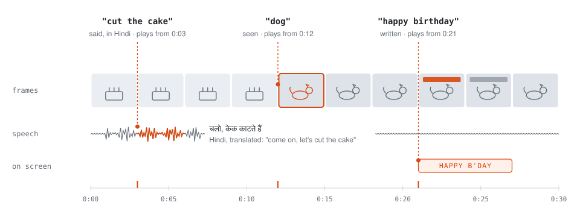

# kshan

Search inside your videos and play from the second it happened.

[](https://github.com/atharva80/kshan/actions/workflows/ci.yml)
[](LICENSE)

kshan (क्षण, "moment" in Hindi and Marathi) adds video search to [Immich](https://immich.app),
the self-hosted photo library. You type what you remember being on screen, said or written, in
English. It opens the clip at that point, even when the words were spoken in Hindi or Marathi.
It runs next to Immich on one laptop with an 8 GB GPU, and nothing leaves the machine.

<picture>
  <source media="(prefers-color-scheme: dark)" srcset="docs/img/moments-dark.svg">
  
</picture>

## Why

This started with five pendrives of family photos and videos, none of it sorted, a phone with
no space left, and the only computer 700 km away. Immich was the obvious home for all of it:
backups, albums, faces, and search that finds "beach at sunset" without anyone tagging anything.

Except for videos. Immich describes a video by its thumbnail and never listens to it. The clip
where the dog runs in at 0:12 doesn't come up for "dog", and a birthday where everyone talks
in Hindi can't be found by anything anyone said. In family video that's most of what's worth
finding. The moment is rarely the first frame, and people switch between Hindi, Marathi and
English in the middle of a sentence while you search in English.

## What it does

For the clip in the picture above:

| You search | It opens |
|---|---|
| `dog` | at 0:12, where the dog walks in |
| `cut the cake` | at 0:03, where someone says *चलो, केक काटते हैं* |
| `happy birthday` | at 0:21, where the banner is on the wall |

It works in Immich's own search bar, on the phone apps too. kshan sits in front of Immich's
search endpoint, asks Immich as usual and blends the video matches into the same response, so
the apps can't tell anything changed. If anything goes wrong, you get Immich's own answer.

A small companion page lists each match as moments ("Said 0:03", "Seen 0:12") and plays from
the one you tap. kshan also writes what it learns back into Immich: one vector for the whole
video, the text seen on screen, and the transcript with an English translation. So even the
plain Immich app searches videos better. There's also a phone-only import for pendrives,
because the person it was built for doesn't own a computer.

## Does it work?

I measured it on public data instead of clips I made myself:

- **[Charades-STA](https://prior.allenai.org/projects/charades):** 80 short everyday videos with
  sentence queries and the time window each one happens in.
- **[FLEURS](https://huggingface.co/datasets/google/fleurs):** the same sentences read aloud in
  Hindi, Marathi and English, searched with the English text.
- **100 queries that have no answer at all.**

Every query searches the whole library. The numbers are the held-out test split (452 queries);
nothing was tuned on it.

| Test split | Immich | kshan |
|---|---:|---:|
| Charades: right video first / in the top 10 | 10.5% / 42.6% | 17.9% / 51.9% |
| Charades: playback starts inside the right moment (±1 s) | | 13.0% |
| English sentence finds the Hindi / Marathi / English clip first | 0 / 0 / 0% | 91.9 / 86.5 / 100% |
| A single rare word finds the clip first | 0% | 50.0% |
| Queries with no answer that still return something | 100% | 7.1% |
| Latency, median / 95th percentile | 38 / 47 ms | 105 / 195 ms |

Building the benchmark paid for itself, because it showed the original score fusion was broken.
The best visual match for any query was rescaled to about 1.0, however weak, so it tied real
spoken matches. Speech on its own found the right clip 96% of the time; the combined system
managed 64%. Turning each signal into a calibrated probability fixed that. Reciprocal rank
fusion, the usual answer, made it slightly worse. Thresholds picked from the data cut answers to
unanswerable queries from 26% to 7%.

Not every number went up. The fusion fix costs 2.5 points on Charades, because Whisper invents
speech in silent clips and those inventions now count. Each change has its before and after in
[eval/results.md](eval/results.md); the datasets, metrics and caveats are in
[docs/evaluation.md](docs/evaluation.md).

## How it works

A background worker picks up new videos from Immich's database, then works through each one:

1. **Frames:** it samples a frame at every scene change. They go through Immich's own ML service:
   SigLIP2 for what's in the frame, OCR for any text. So frames and your photos share one
   embedding space.
2. **Speech:** Whisper large-v3 transcribes the audio, and a second pass translates
   non-English speech to English.
3. **Meaning:** transcripts get bge-m3 vectors, for matching by meaning.

Everything lands in a schema inside Immich's own Postgres, so it's part of Immich's backups.

At search time it looks for the query three ways:

- **Seen:** frame vectors.
- **Said:** the exact words and the meaning, in the transcript or its translation.
- **Written:** on-screen text, matched as whole words, so "cat" no longer matches "vacation".

Each kind of match becomes a probability that this is the right video, and those probabilities
are combined. The best moment in each video is where playback starts. A search takes about
100 ms.

The service is called `vsearch` in the code. [docs/architecture.md](docs/architecture.md) has
the pipeline and data model, and [docs/decisions.md](docs/decisions.md) has what else was
tried and why it lost.

## Setup

You need Linux with Docker Compose 2.24 or newer, an NVIDIA GPU with 8 GB (CPU works, slowly),
and Immich v3 (tested on 3.3.5).

```bash
# 1. Install Immich the official way: https://docs.immich.app/install/docker-compose
#    (deploy/01-btrfs-setup.sh prepares a btrfs layout first, if you're on btrfs)

# 2. Let containers use the GPU
sudo bash deploy/02-gpu-setup.sh

# 3. Add kshan next to Immich's docker-compose.yml
cd /path/to/immich-app
git clone https://github.com/atharva80/kshan vsearch
cp vsearch/deploy/docker-compose.override.yml .
docker volume create immich-vsearch-models
docker compose up -d --build

# 4. In Immich: Administration > Settings > Machine Learning > Smart Search,
#    set the model to ViT-SO400M-16-SigLIP2-384__webli and re-run the Smart Search job

# 5. Optional: reach it privately from anywhere over Tailscale
sudo bash vsearch/deploy/03-tailscale-serve.sh
```

Videos already in Immich get indexed on their own. The search page is at `http://127.0.0.1:2284`,
or `https://<machine>.<tailnet>.ts.net:8443/vsearch/` over Tailscale.
[docs/setup.md](docs/setup.md) walks through all of it from an empty machine.

## Reproducing the numbers

```bash
make eval-data                       # Charades clips via HTTP range requests (not the 16 GB zip), FLEURS
pip install -r requirements-dev.txt
pytest -q                            # 246 tests; CI runs them against a real Postgres
```

The rest of the run (a throwaway Immich, indexing, querying every system, tuning on dev and
scoring on test) is in [docs/evaluation.md](docs/evaluation.md).

## Limitations

- **The benchmark isn't family video.** Charades is staged indoor footage and FLEURS is clean
  read speech. Noisy, code-mixed conversation will be harder.
- **8 GB is tight.** Whisper large-v3 only fits next to SigLIP2 while Immich's text model isn't
  loaded. Searching a lot during heavy indexing can push Whisper onto the CPU.
- **Marathi is the weak spot for one-word searches:** 18.9% found first, against 43.2% for
  Hindi and 88.9% for English. A rare word has to survive transcription and then translation.
- **The search bar keeps Immich's own top result first** unless a video matched the exact
  words. Sentence searches rarely reach #1 there, though 93.6% land in the top 10. The
  companion page doesn't have this problem.
- **The phone apps can't jump to a second**, because they're native apps. That's what the
  companion page is for.
- **It reads and writes Immich's internal tables**, because Immich has no plugin API yet. It
  checks the schema before every pass and stops rather than write into a layout it doesn't know.

## Credits

[Immich](https://github.com/immich-app/immich) (AGPL-3.0). kshan only talks to it and ships none
of its code. [faster-whisper](https://github.com/SYSTRAN/faster-whisper) with OpenAI's Whisper
large-v3, [BAAI/bge-m3](https://huggingface.co/BAAI/bge-m3), and Google's SigLIP2 and PaddleOCR
through Immich.

Benchmark data:
- Charades (Sigurdsson et al. 2016) and Charades-STA (Gao et al. 2017), for non-commercial use.
  Only the download scripts are included.
- FLEURS (Conneau et al. 2022), CC BY 4.0.

MIT licensed. See [LICENSE](LICENSE).
