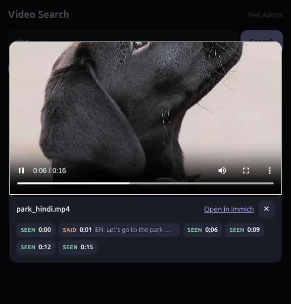
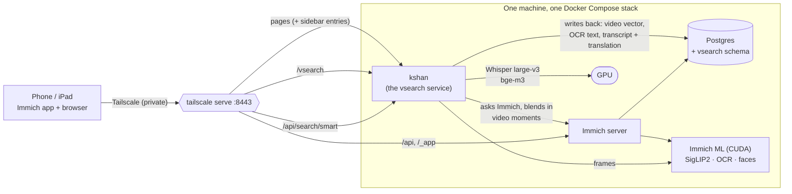

# kshan · क्षण

**Find the moment, not just the video.**

kshan (*क्षण*, "moment" in Hindi and Marathi) searches **inside** the videos in your
[Immich](https://immich.app) library, by what's **on screen**, what's **said** (Hindi, Marathi,
English and ~95 other languages, from plain English queries) and what's **written**, and plays
from the exact second. It works in Immich's own search bar, runs on one laptop GPU, and never
sends a frame to the cloud.

[](https://github.com/atharva80/kshan/actions/workflows/ci.yml)
[](LICENSE)


<p align="center">
  
</p>

> Searching **"dog"** found a clip where someone says *"चलो आज शाम को कुत्ते के साथ पार्क में
> घूमने चलते हैं"* in Hindi. The translation pass turned that into *"Let's go to the park with
> the dog this evening"*, and the player opened at **0:01**.

---

## The problem

Photo apps have become good at searching photos. **Videos are still black boxes.**

[Immich](https://immich.app), the self-hosted Google Photos, describes a video by **one frame**,
its thumbnail. A 30-second clip where the cat walks in at 0:20 doesn't exist for "cat". The
audio isn't searched at all, so "the clip where everyone sings happy birthday" can't be found.

Family video in India makes this worse:
- **Things happen mid-clip.** The thumbnail is rarely the moment you remember.
- **People talk in two or three languages at once**: Hindi, Marathi, English, often in one
  sentence. You search in English.
- **The memories are scattered.** This project started with 4–5 unsorted pendrives, a phone
  and an iPad that were both full, and their owner 700 km from the only computer.

The constraints: one laptop (an 8 GB RTX 2000 Ada), no cloud, no new app to install, and
private remote access.

## What kshan does

| | |
|---|---|
| 🎞️ **Seen** | Samples a frame at every scene change (at least every 3 s), embeds each with the **same CLIP model as Immich** (SigLIP2), so frames live in the same space as your photos |
| 🗣️ **Said** | Transcribes speech with **Whisper large-v3**, then runs a **translation pass** for non-English speech, so plain English words find Hindi and Marathi. **bge-m3** embeddings match by meaning and paraphrase |
| 🔤 **Written** | Immich's own OCR on every sampled frame, matched as **whole words** ("cat" never hits "vacation"; "goa 2023" finds "GOA2023") |
| 🔎 **In Immich's search bar** | Proxies `POST /api/search/smart`, asks Immich as usual, and blends in video moments with Immich's exact response format. The phone apps can't tell, and **any error falls back to Immich's own answer** |
| ⏱️ **Jump to the second** | A companion page with moment chips ("Seen 0:20", "Said 1:12 *'happy birthday…'*", "Written 0:08"), linked from Immich's sidebar |
| 🧠 **Makes plain Immich smarter too** | Writes a scene-balanced video vector, frame OCR text and the 🎙 transcript + 🌐 translation back into Immich, so even the unmodified app searches better, and puts them back if Immich's jobs overwrite them |
| 📱 **Phone-only pendrive import** | Plug a pendrive into a phone, pick folders in the browser: in-browser SHA-1 dedup, an album per folder, resumable overnight runs |

## Does it work? A public benchmark

Measured on public data, not on clips we made: **[Charades-STA](https://prior.allenai.org/projects/charades)**
(everyday videos with time-stamped sentence queries) and **[FLEURS](https://huggingface.co/datasets/google/fleurs)**
(read speech in Hindi, Marathi and English, searched with **English** queries), plus 100
queries with **no** answer. Every query searches the whole library in a throwaway Immich.
Numbers are the held-out **test split** (452 queries); thresholds and fusion were tuned on dev only.

| Test split | Plain Immich | kshan |
|---|---:|---:|
| Charades: right video first / in top 10 | 10.5% / 42.6% | **17.9% / 51.9%** |
| Charades: playback starts inside the right moment (±1 s) | – | **13.0%** |
| English sentence → **Hindi** / **Marathi** / English clip first | 0% / 0% / 0% | **91.9% / 86.5% / 100%** |
| One-word keyword → clip first | 0% | **50.0%** |
| Queries with no answer that still return something | 100% | **7.1%** |
| Latency p50 / p95 | 38 / 47 ms | 105 / 195 ms |

"Plain Immich" already includes kshan's write-back; before any indexing it found the Charades
video in the top 10 only 35.8% of the time.

The benchmark also **found real bugs**, and the fixes went in one commit each with before/after
numbers ([eval/results.md](eval/results.md)):

- **Calibrated score fusion.** Each query's best visual frame was rescaled to score ~1.0,
  however weak, so it tied genuine spoken matches. Speech alone found the right clip 96.4% of
  the time, but the fused system only 63.6%. A per-kind logistic calibration fixed it (63.6% →
  96.4%). The textbook alternative, reciprocal rank fusion, did *worse*.
- **Thresholds from data**, not five hand-picked sentences: answers to unanswerable queries
  went from 25.7% to 7.1%, for a few points of recall.
- **Whole-word matching** for speech and OCR, including Devanagari, where a vowel sign or a
  full stop (।) must not count as a word boundary.

Not everything improved, and the tables say so: calibrated fusion costs 2.5 points of
Charades R@1, because Whisper hallucinates speech in silent clips. Full method, datasets
(pinned by sha256), metric definitions and limitations: **[docs/evaluation.md](docs/evaluation.md)**.

## How it works



1. **Index.** A background worker finds new videos in Immich's database, waits for Immich's own
   processing, samples frames, embeds them and reads their text through Immich's ML container,
   transcribes and translates the audio, and embeds the transcript. One video's results land
   in one transaction, in a `vsearch` schema inside Immich's own Postgres (so they're in
   Immich's backups).
2. **Search.** `search.py` fetches candidates: HNSW over frame vectors, HNSW over speech
   vectors, and whole-word regex over transcripts and OCR on the existing trigram indexes.
   `ranking.py`, which is pure and tested on its own, turns each kind's similarity into
   P(right video) and combines kinds by noisy-OR, then groups moments per video.
3. **Blend.** For the search bar, it asks Immich, then weaves in video moments. Filtered
   searches (people, places, dates, photos only) pass through untouched.

The service is called `vsearch` in the code; kshan is the project.

## Quick start

Requirements: Linux with Docker Compose ≥ 2.24, an NVIDIA GPU with ≥ 8 GB VRAM (CPU-only works,
slowly), Immich v3 (tested on 3.3.5).

```bash
# 1. Immich, the official way: https://docs.immich.app/install/docker-compose
#    (deploy/01-btrfs-setup.sh sets up a btrfs layout first, if you're on btrfs)

# 2. GPU for containers
sudo bash deploy/02-gpu-setup.sh

# 3. Add the service next to Immich's docker-compose.yml
cd /path/to/immich-app
git clone https://github.com/atharva80/kshan vsearch
cp vsearch/deploy/docker-compose.override.yml .
docker volume create immich-vsearch-models
docker compose up -d --build

# 4. In Immich: Administration > Settings > Machine Learning > Smart Search >
#    model = ViT-SO400M-16-SigLIP2-384__webli   (then re-run the Smart Search job)

# 5. Optional: private access from anywhere via Tailscale
sudo bash vsearch/deploy/03-tailscale-serve.sh
```

The page is at `http://127.0.0.1:2284`, or at `https://<machine>.<tailnet>.ts.net:8443/vsearch/`
over Tailscale. Videos already in Immich get indexed automatically. Full walkthrough:
**[docs/setup.md](docs/setup.md)**.

## Run the benchmark yourself

```bash
make eval-data     # downloads Charades-STA clips (range requests, not the 16 GB zip) + FLEURS
# then the steps in docs/evaluation.md: load a throwaway Immich, record plain Immich, index,
# query every system, tune on dev, score on test
pip install -r requirements-dev.txt && pytest -q     # 246 unit tests; CI runs them with Postgres
```

## Documentation

| | |
|---|---|
| [Evaluation](docs/evaluation.md) | The benchmark: datasets, splits, metrics, results, the fixes it drove, limitations |
| [Setup](docs/setup.md) | From an empty machine to everything running: btrfs, Immich, GPU, the service, Tailscale |
| [User guide](docs/user-guide.md) | For the person using it: connecting, uploading phone photos and pendrives, searching |
| [Architecture](docs/architecture.md) | Pipeline, data model, write-back, scene pooling, ranking, auth |
| [Models](docs/models.md) | Which models and why, with benchmarks and calibration |
| [Decisions](docs/decisions.md) | Every fork in the road: what was considered, what was picked, why |
| [Testing](docs/testing.md) | Unit tests, the 50-check end-to-end harness, bugs found along the way |
| [Operations](docs/operations.md) | Updates, backups, monitoring, re-indexing, troubleshooting |

## Limits, honestly

- **The benchmark isn't family video.** Charades is staged indoor video; FLEURS is clean read
  speech. Real code-mixed, noisy conversation will be harder.
- **Small GPU, careful juggling.** On 8 GB, Whisper large-v3 fits next to SigLIP2 only while
  Immich's text model isn't loaded. Searching during heavy indexing can push Whisper to CPU.
- **Marathi is the weak spot** for one-word queries (18.9% first-hit vs 43.2% Hindi and 88.9%
  English): a rare word has to survive transcription *and* translation.
- **The search bar** keeps Immich's own #1 unless a video matched the exact words, so sentence
  queries rarely reach #1 there (93.6% in the top 10). The companion page has no such limit.
- **The phone apps can't jump to a second**, because they're native; that's what the companion
  page is for.
- **It reads and writes Immich's internal tables** (there's no plugin API yet). It checks the
  schema before every pass and pauses rather than write into a layout it doesn't recognize.

## Credits

[Immich](https://github.com/immich-app/immich) (AGPL-3.0); kshan only talks to it and ships none of
its code. [faster-whisper](https://github.com/SYSTRAN/faster-whisper) / OpenAI Whisper large-v3,
[BAAI/bge-m3](https://huggingface.co/BAAI/bge-m3), Google SigLIP2 and PaddleOCR via Immich.
Benchmark data: Charades and Charades-STA (Sigurdsson et al. 2016; Gao et al. 2017,
non-commercial; only download scripts are included), FLEURS (Conneau et al. 2022, CC BY 4.0).
The screenshot shows [this photo](https://commons.wikimedia.org/wiki/File:DSC09611a_Search_and_Rescue_Dog,_Austrian_Red_Cross_Perchtoldsdorf,_2024-10.jpg)
by Aciarium, CC BY 4.0.

MIT licensed. See [LICENSE](LICENSE).
