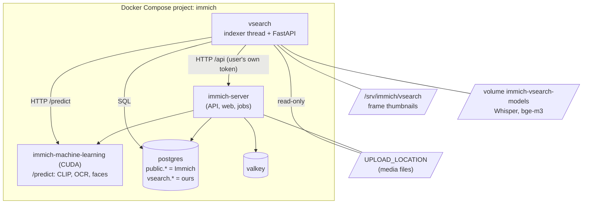
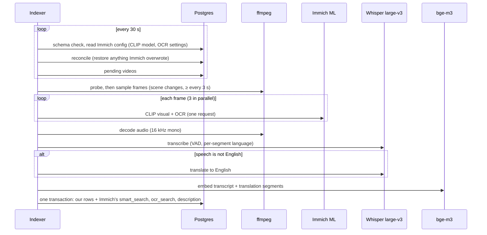
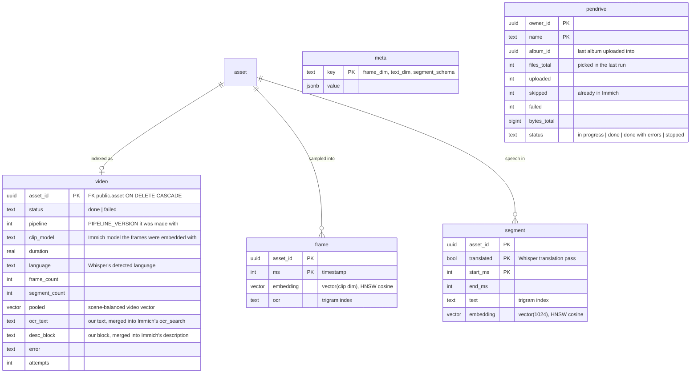
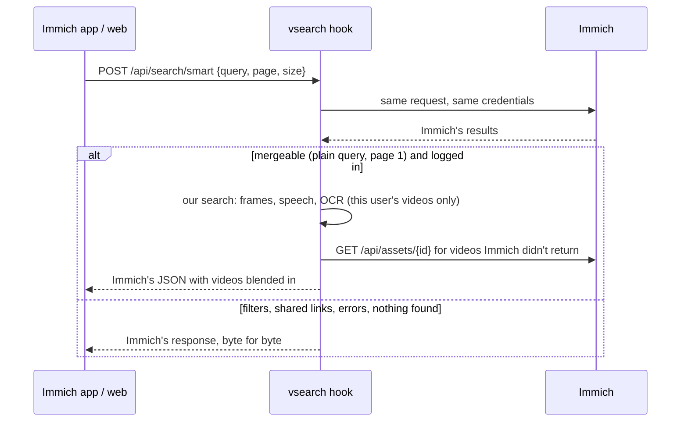

# Architecture

How `vsearch` works inside, and how it fits around Immich without forking it.

- [Components](#components)
- [The indexing pipeline](#the-indexing-pipeline)
- [Data model](#data-model)
- [Writing back into Immich](#writing-back-into-immich)
- [Keeping results in place (reconcile)](#keeping-results-in-place-reconcile)
- [Scene-balanced pooling](#scene-balanced-pooling)
- [The search side](#the-search-side)
- [Inside Immich's own search bar](#inside-immichs-own-search-bar)
- [Sidebar entries inside Immich's web UI](#sidebar-entries-inside-immichs-web-ui)
- [Pendrive uploads from a phone](#pendrive-uploads-from-a-phone)
- [Web app, auth and playback](#web-app-auth-and-playback)
- [Safety rails](#safety-rails)
- [Code map](#code-map)

## Components



`vsearch` is one Python process with two parts:

| Part | Runs in | Does |
|---|---|---|
| **Indexer** | a background thread | polls Postgres every 30 s, indexes new videos, repairs anything Immich overwrote |
| **Web app** | uvicorn (FastAPI) | serves the search page and its API on port 2284 |

It talks to three things:
- **Postgres**, directly, as the same DB user Immich uses (credentials come from Immich's `.env`).
- **Immich's ML container** at `/predict`, for CLIP vectors and OCR. It loads no vision model of its own.
- **The Immich API**, only on behalf of a logged-in user: validating their session, streaming
  video, creating albums.

It mounts the media library **read-only**. It never modifies, moves or re-encodes a file.

## The indexing pipeline



### 1. Which videos

`db.pending_videos()` selects videos that:
- are `type = 'VIDEO'`, not deleted, not offline, and visible in the timeline or archive.
  That skips hidden live-photo clips and the locked folder.
- have `asset_job_status."metadataExtractedAt"` set. Immich's metadata pass writes the
  description from the file, so writing ours earlier would get overwritten.
- were uploaded at least `VSEARCH_SETTLE_SECONDS` (60 s) ago, so the storage-template move has
  happened and the file path is final.
- and are new, from an older pipeline version, indexed with a different CLIP model, or failed
  fewer than 3 times (with backoff: 10 min × attempts).

### 2. Frame sampling (`media.sample_frames`)

A single ffmpeg pass with a `select` filter:

```
isnan(prev_selected_t)                                  first frame
+ gte(t - prev_selected_t, max_gap)                     at least every max_gap seconds
+ gt(scene, 0.3) * gte(t - prev_selected_t, min_gap)    on scene changes, not too close together
```

- `max_gap = max(3 s, duration / 300)` and `min_gap = max(1 s, max_gap / 3)`, so long videos
  never exceed ~300 frames.
- Videos longer than 10 minutes decode **keyframes only** (`-skip_frame nokey`). Scene
  detection would mean decoding every frame of a two-hour file.
- Frames are scaled so the long edge is ≤ 960 px. That's plenty for SigLIP2 (384 px) and
  OCR (736 px).
- Timestamps come from the `showinfo` filter and are stored as integer milliseconds.

### 3. Vision and OCR through Immich's ML

Each frame goes to `POST /predict` with:

```json
{"clip": {"visual": {"modelName": "<Immich's current CLIP model>"}},
 "ocr":  {"detection":   {"modelName": "PP-OCRv5_mobile", "options": {"minScore": 0.5, "maxResolution": 736}},
          "recognition": {"modelName": "PP-OCRv5_mobile", "options": {"minScore": 0.8}}}}
```

The model names and thresholds are read from Immich's own `system-config`, so they always
match what Immich uses for photos. When Immich switches CLIP models, every video's visuals are
redone automatically. Transcripts are kept, because they don't depend on the vision model.

### 4. Speech (`speech.py`)

- Audio is decoded by ffmpeg to 16 kHz mono float32. faster-whisper's own PyAV-based decoding
  breaks on current PyAV releases.
- Whisper large-v3 runs on CUDA as `int8_float16` (~1.8 GB VRAM), with these settings:
  - VAD on, so silence and music aren't transcribed
  - `multilingual=True` (per-segment language detection, for Hinglish and mixed speakers)
  - `condition_on_previous_text=False` (so one hallucination doesn't cascade)
- Hallucination filter: segments are dropped when they have no letters or digits, a high
  no-speech probability with low confidence, a repetition loop (compression ratio > 2.6), or
  are classic phantom phrases ("thank you for watching") with low confidence.
- **Translation pass:** if the detected language isn't English, or the text contains non-ASCII
  letters, a second decode runs with `task="translate"`. Its segments are stored with
  `translated = true`.
- The model loads lazily, unloads after 5 idle minutes to free VRAM, and falls back to CPU (int8)
  if CUDA fails.

### 5. Text embeddings (`textemb.py`)

`BAAI/bge-m3` via sentence-transformers on CPU (8 threads), normalized 1024-dim vectors for
every transcript and translation segment. The same model embeds search queries at query time.

## Data model

Everything lives in a `vsearch` schema inside Immich's own database. That means it can join
against `public.asset`, Immich's nightly database dumps include it, and foreign keys clean it
up when Immich deletes an asset.



- **`frame.embedding` has the CLIP model's dimension** (1152 for SigLIP2 SO400M). It's fixed
  so it can carry an HNSW index. When the dimension changes, `ensure_schema` recreates the
  table and marks the visuals for redoing.
- **`segment` is versioned through `meta.segment_schema`**, and the speech is redone when it changes.
- **Frame thumbnails** (360 px WebP) live on disk at `/state/frames/<asset_id>/<ms>.webp`.
  Directories of deleted videos get removed on the next pass.

## Writing back into Immich

All of this happens in **one transaction** per video (`db.save_video`):

| Immich table | What we write | Why it's safe |
|---|---|---|
| `smart_search` | `(assetId, pooled vector)`, upsert | Same model and dimension as Immich's own vectors; one row per asset, as Immich expects |
| `ocr_search` | Immich's own text **+** our OCR text | Merged, never replaced. Our part is tracked in `video.ocr_text` so it can be swapped cleanly |
| `asset_exif.description` | existing description **+** our block | Merged, never replaced. Our block is tracked in `video.desc_block`; a description she wrote herself stays |

The description block looks like this:

```
🎙 चलो आज शाम को कुत्ते के साथ पार्क में घूमने चलते हैं
🌐 Let's go to the park with the dog this evening.
```

`asset_exif` has an `updated_at()` trigger that bumps `updateId`, so **the mobile apps sync
the new description** like any edit made in the UI.

Immich's search then finds videos through its normal code paths:
- smart search: cosine distance on `smart_search`
- OCR search: `f_unaccent(ocr_search.text) %>> query` (strict word similarity)
- description search: `ILIKE` on `asset_exif.description`

## Keeping results in place (reconcile)

Immich rewrites these tables on its own schedule. Re-running Smart Search writes back the
thumbnail vector, re-running OCR writes back the thumbnail text, and "Refresh metadata" resets
the description. Every pass, `db.reconcile()` checks and repairs:

```sql
-- vectors: put ours back wherever it differs
insert into smart_search ("assetId", embedding)
select v.asset_id, v.pooled from vsearch.video v
where v.status = 'done' and v.clip_model = :current_model and vector_dims(v.pooled) = :dim
on conflict ("assetId") do update set embedding = excluded.embedding
where smart_search.embedding <> excluded.embedding;
```

OCR text and descriptions get the same treatment through `merge_ocr` and `merge_description`,
wherever our part is missing. Repairs are logged as
`restored what Immich overwrote: {'smart_search': 1, 'ocr': 1, 'description': 1}`.
The end-to-end test overwrites all three and checks they come back within one pass.

## Scene-balanced pooling

Immich stores **one vector per asset**, so the video's frames have to collapse into one.
A plain average fails on exactly the case this project exists for. In the test video the cat
appears in 2 of 12 sampled frames, so the average is 83% lake and food. For "a cat", two dog
videos then rank above it.

So frames are first grouped into scenes, and each scene counts once:

```python
scenes = []
for e in normalized(frame_embeddings):           # in time order
    sims = [cos(scene_centroid, e) for scene in scenes]
    if sims and max(sims) >= 0.82:
        scenes[argmax(sims)] += e                # same scene (or a scene coming back)
    else:
        scenes.append(e)                         # new scene
pooled = normalize(mean(normalize(s) for s in scenes))
```

The lake, food and cat now weigh one third each. In Immich's own smart search, the cat video
moved from **#5 to #2** for "a cat", behind only an actual cat photo. Every other query kept its
correct top result. The result held for thresholds 0.75–0.9; 0.82 sits in the middle.

## The search side

`search.py` only fetches **candidates** `(video, ms, kind, method, similarity, text)` from up to
three sources, filtered to the requesting user's live, visible videos; `ranking.py` (pure, stdlib)
applies thresholds, scores, fusion and moment grouping. The benchmark (`eval/`) re-ranks saved
candidates with the same `ranking.py`, so its numbers are what the live code does.

| Kind | Candidates | Kept if |
|---|---|---|
| **visual** ("Seen") | query → Immich ML CLIP text vector → HNSW over `frame.embedding` (`ef_search` 400, iterative scan), top 400 frames | similarity ≥ max(0.09, best − 0.06) and within 0.03 of the video's own best frame |
| **speech** ("Said") | 1) the query's words, **whole words**, in transcript or English translation (`lexical.py` regex on the trigram index) 2) bge-m3 vector → HNSW over `segment.embedding`, top 100 | meaning matches ≥ 0.63 and within 0.15 of the best |
| **text** ("Written") | the query's words, whole words, in frame OCR, with separators optional between letters and digits ("goa 2023" ↔ "GOA2023"); strict trigram similarity for misreads, queries of 5+ characters | |

**Fusion per video:** each kind's best match is turned into P(right video) by a logistic fit
per kind and method (`ranking.CALIBRATION`, fitted on the benchmark's dev split), and kinds
combine by noisy-OR: `1 − Π(1 − p)`. Floors and calibration come from the benchmark
([evaluation.md](evaluation.md), decisions 19–20); the original rescaled scores and
`max + 0.1·rest` are kept as `ranking.LEGACY`. Moments of the same kind closer than 2.5 s
collapse into one, up to 6 per video, each with the nearest sampled frame as its thumbnail.

## Inside Immich's own search bar

`tailscale serve` routes exactly one Immich endpoint, `POST /api/search/smart`, to
`vsearch` (`/hook/smart-search`). Every other request goes straight to Immich.



- **When it merges:** only for requests with just `query`, `page`, `size`, and a few harmless
  flags (`immich_search.MERGEABLE_FIELDS`). People, places, dates, albums, "similar to this
  photo", photos-only and shared-link searches pass through unchanged, because our results
  can't honor those filters.
- **Ordering (`immich_search.blend`):**
  - Videos where the query was **said or written exactly** go first.
  - Other video matches go near the top (slots 1, 3, 5, …), never lower than where Immich
    already ranked them.
  - Everything else keeps Immich's order.
- **Page 2 and beyond:** videos that were moved onto page 1 are removed, so they don't show twice.
- **Fidelity:** extra videos are fetched with `GET /api/assets/{id}` as the user, so every item
  is the exact object Immich would return, and the apps can't tell the difference.
- **Credentials:** the hook forwards the user's own credentials (cookie, Bearer,
  `x-immich-user-token` from the mobile apps, API key), and Immich does the authentication.
- **Failure mode:** any exception falls back to Immich's untouched response. The one hard
  dependency is that the vsearch container must be running (`restart: always`).

## Sidebar entries inside Immich's web UI

Immich has no plugin hook for its UI, so vsearch passes Immich's **pages** through and adds
one **inline** `<script data-vsearch-sidebar>` (the contents of `static/sidebar.js`) before `</head>`.
It's inline on purpose: some browsers and blockers refuse separate script files from a tailnet
host (`ERR_BLOCKED_BY_CLIENT`), which left the companion page blank during testing. For the same
reason the page inlines `lib.js` (SHA-1, filename dates) when it's served.

| Tailscale route | Goes to | Why |
|---|---|---|
| `/` | vsearch `/immich-web/...` | HTML pages (and small root files like `manifest.json`), with the script added |
| `/api` | Immich | API, uploads, websockets (`/api/socket.io`): never touch vsearch |
| `/_app` | Immich | the web app's JS/CSS bundles |
| `/api/search/smart` | vsearch hook | the merged search (longest prefix wins) |
| `/vsearch` | vsearch | the companion page |

`sidebar.js` (deliberately not called inject.js: ad blockers filter names like that, and an earlier `upload.js` got blocked):
- **finds** Immich's sidebar link to `/explore`
- **clones** a non-active sibling link twice, so the new entries get exactly Immich's markup
  and styling
- **relabels** them "Find in videos" / "Pendrives" with their own icons
- **adds** `data-sveltekit-reload`, so clicking does a real page load instead of a client-side
  route Immich doesn't know
- **watches** with a `MutationObserver` (batched per animation frame), so the entries come back
  when Immich re-renders the sidebar: navigation, the phone menu, resizing

If the sidebar can't be found, it does nothing, so a future Immich layout change degrades to
plain Immich rather than breaking it.

**Tested** on a real Immich v3.3.5 web UI: both entries appeared after Explore, styled
natively, and survived navigating Explore → Albums → Photos. Immich sends no
Content-Security-Policy that would block the script.

## Pendrive uploads from a phone

The **Pendrives** tab is built for someone with only a phone and an OTG adapter. Everything
happens in the browser, talking to Immich's own API on the same origin:

1. **Pick:** the Android or iOS file picker shows the USB drive. Media files are kept
   (by extension or MIME type), and a file picked twice is counted once.
2. **Albums:** each file's album is decided when it's picked: a whole-folder pick gives `<pendrive> - <folder>` (from `webkitRelativePath`; when the picked folder holds only folders, each first-level folder is its own album), hand-picked files give `<pendrive> - Individual - <name>`. Each album is created, or reused if the user already owns one with that name (case-insensitive; the owner comes from `albumUsers`). The pendrive list finds a pendrive's albums by that name prefix.
3. **Fingerprint:** `lib.js` hashes each file with a streaming SHA-1 in 4 MB slices, so
   multi-GB videos never sit in memory. It matches Node's crypto on 70 test vectors, at
   ~185 MB/s on desktop.
4. **Ask Immich what it has:** `POST /api/assets/bulk-upload-check` in batches of 20. Files
   Immich already holds (from an earlier run, or another pendrive) are skipped, and their
   existing IDs are added to the album.
5. **Upload** the rest, 2 at a time, with `POST /api/assets` (multipart). If a filename
   carries a date (`IMG-20190512-WA0001`, `PXL_20210630_101112345`, `Screenshot_2022-03-04-10-11-12`,
   `WhatsApp Video 2021-08-15 at 21.04.33`), it's sent as `fileCreatedAt`. Immich uses that
   when the file has no EXIF date, and EXIF still wins when present.
6. **Retries:** network and 5xx errors wait until `/api/server/ping` answers again, then back
   off (2 s → 60 s, 5 tries). A 401 shows the login form. Other 4xx errors mark the file failed,
   and a *Retry failed* button re-runs just those.
7. **Album and progress:** IDs are added to the album in batches. Progress is saved to
   `vsearch.pendrive` every 10 s and at the end, so the list survives closing the page and
   shows from any device.
8. **Staying awake:** the Screen Wake Lock API keeps the phone awake while uploading, and
   re-acquires the lock when the page becomes visible again.

Because skipping is by content checksum, **stopping and re-picking the same files is always
safe**. That's the resume mechanism.

**Built to survive a night on a phone:**
- **Time limits:** every request has one (API 60 s; an upload gets max(10 min, size at 30 KB/s)),
  so a silently dead connection can't hang the run.
- **Duplicate checks retry:** they wait for the server to come back instead of aborting.
  Whatever fails, the upload workers always stop, and progress reporting stops with them.
- **Unreadable files:** a file that can't be read is marked failed and the run continues. Five
  unreadable files in a row means the pendrive came loose, so the run stops with a clear
  message instead of failing every file.
- **Album adds retry:** if one still fails, re-picking the files adds them later. A file is
  never uploaded but silently missing from its album.
- **Album ownership:** only her own album with that name is reused, never an album someone shared with her.
- **Instant resume:** each file's fingerprint (keyed by name + size + date) is kept in the
  phone's IndexedDB. After the app is killed, re-picking the same files reads **0 bytes** from
  the pendrive. Immich still confirms which ones it has, so deleting something in Immich
  re-uploads it.
- **Installable app:** manifest, PNG icons and a pass-through service worker scoped to
  `/vsearch/`. No caching, and Immich's pages are never touched.

**What it can't do:** run in the background. Android freezes pages that aren't on screen, so
long runs need the app open, the screen on (it holds a wake lock) and the phone charging.

## Web app, auth and playback

- **Where it lives:** Tailscale serve publishes Immich at `https://<host>:8443/` and this app at
  `https://<host>:8443/vsearch`. Same origin, so the app receives Immich's
  `immich_access_token` cookie. A small ASGI wrapper (`StripPrefix`) accepts paths with or
  without `/vsearch`, and the page computes its base path in JS, so it works at both URLs.
- **Auth:** every API call resolves to an Immich user by calling `GET /api/users/me` with the
  caller's cookie, bearer token or `x-api-key` (cached for 2 min). The page has a login form
  that posts to Immich's `/api/auth/login` and sets the same cookies Immich's web app does, so
  logging in on either logs into both.
- **Isolation:** search SQL filters by `ownerId`. Thumbnail, playback and album endpoints check
  the asset belongs to the caller and return 404 otherwise.
- **Playback:** `/api/play/{id}` proxies Immich's `/api/assets/{id}/video/playback` with the
  user's own token and passes `Range` through, so Immich handles transcoded versions and
  seeking (HTTP 206). The player seeks to the moment on `loadedmetadata`.
- **Albums:** "Save these videos as an Immich album" calls Immich's `POST /api/albums` as the user.
- Immich's web service worker only intercepts `/api/assets/*/original|thumbnail`, so it never
  catches `/vsearch`.

## Safety rails

- **Schema check before every pass:** `db.REQUIRED` lists every Immich table and column touched.
  If an Immich upgrade changes them, the indexer logs `Immich's database layout changed`,
  reports `paused` in `/health`, and writes nothing.
- **Immich's own schema check stays clean:** `immich-admin schema-check` reports
  `No schema drift detected` with the `vsearch` schema present.
- **Foreign keys** to `public.asset ... ON DELETE CASCADE`: deleting a video in Immich deletes its index.
- **Read-only media mount,** and only videos are touched. Photos, live-photo clips, the locked
  folder and trash are not.
- **Failures are contained:** a broken file is marked `failed` with the error and retried
  twice with backoff, and it never blocks other videos.

## Code map

| File | Responsibility |
|---|---|
| `vsearch/indexer.py` | the loop, per-video orchestration, thumbnail housekeeping |
| `vsearch/media.py` | ffprobe, scene sampling, thumbnails |
| `vsearch/mlclient.py` | Immich ML `/predict` client (CLIP visual/text, OCR) |
| `vsearch/speech.py` | ffmpeg audio decode, Whisper transcribe + translate, hallucination filter, VRAM lifecycle |
| `vsearch/textemb.py` | bge-m3 |
| `vsearch/db.py` | schema, Immich config/schema checks, pooling, save + merge + reconcile |
| `vsearch/search.py` | the three candidate sources (SQL) |
| `vsearch/ranking.py` | thresholds, scores, calibrated fusion, moment grouping (pure; used by eval/) |
| `vsearch/lexical.py` | whole-word phrase patterns for exact speech/OCR matches |
| `vsearch/web.py` | FastAPI routes, auth, prefix handling, playback proxy, search-bar hook, pendrive progress |
| `vsearch/immich_search.py` | which search-bar requests get merged, and the blend order |
| `vsearch/static/index.html` | the whole page: Search + Pendrives tabs (vanilla JS, mobile-first, light/dark) |
| `vsearch/static/lib.js` | streaming SHA-1, filename dates, media filter |
| `vsearch/static/sidebar.js` | the two sidebar entries inside Immich's web UI |
| `vsearch/config.py` | every setting, from environment variables |
| `eval/` | the benchmark: data scripts, load/live/collect, tune, run, metrics, report |
| `tests/` | unit tests (ranking equivalence, fusion, metrics, lexical incl. real Postgres); CI in `.github/workflows/ci.yml` |
