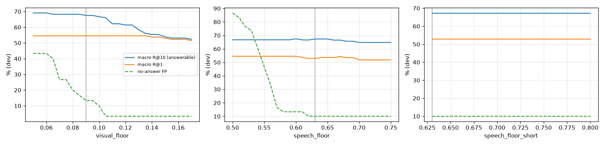

# Tuning on the dev split

Generated by `eval/tune.py`. Only dev queries are used here; the chosen settings are then scored on test in [results.md](results.md).

| Setting | macro MRR | macro R@1 | macro R@10 | no-answer FP |
|---|---:|---:|---:|---:|
| baseline (as shipped) | 0.491 | 36.7 | 68.3 | 26.7 |
| fix A: whole-word match | 0.491 | 36.7 | 68.3 | 26.7 |
| fix A + fusion: legacy | 0.491 | 36.7 | 68.3 | 26.7 |
| fix A + fusion: rrf k=10 | 0.482 | 33.6 | 68.3 | 26.7 |
| fix A + fusion: rrf k=30 | 0.482 | 33.6 | 68.3 | 26.7 |
| fix A + fusion: rrf k=60 | 0.482 | 33.6 | 68.3 | 26.7 |
| fix A + fusion: calibrated | 0.587 | 54.5 | 68.3 | 26.7 |
| fix A + B, untuned floors | 0.587 | 54.5 | 68.3 | 26.7 |
| fix A + B + C: tuned floors | 0.572 | 52.9 | 67.3 | 10.0 |

Fusion kept: **calibrated**. Floors chosen: `{"visual_floor": 0.09, "speech_floor": 0.63, "speech_floor_short": 0.63}` (lowest no-answer FP with macro R@10 within 1 point of untuned).

